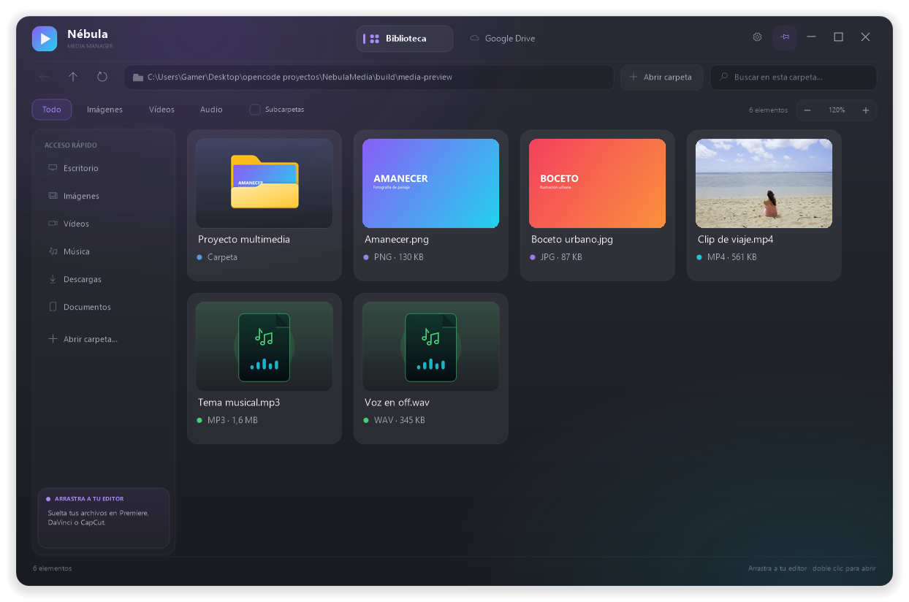
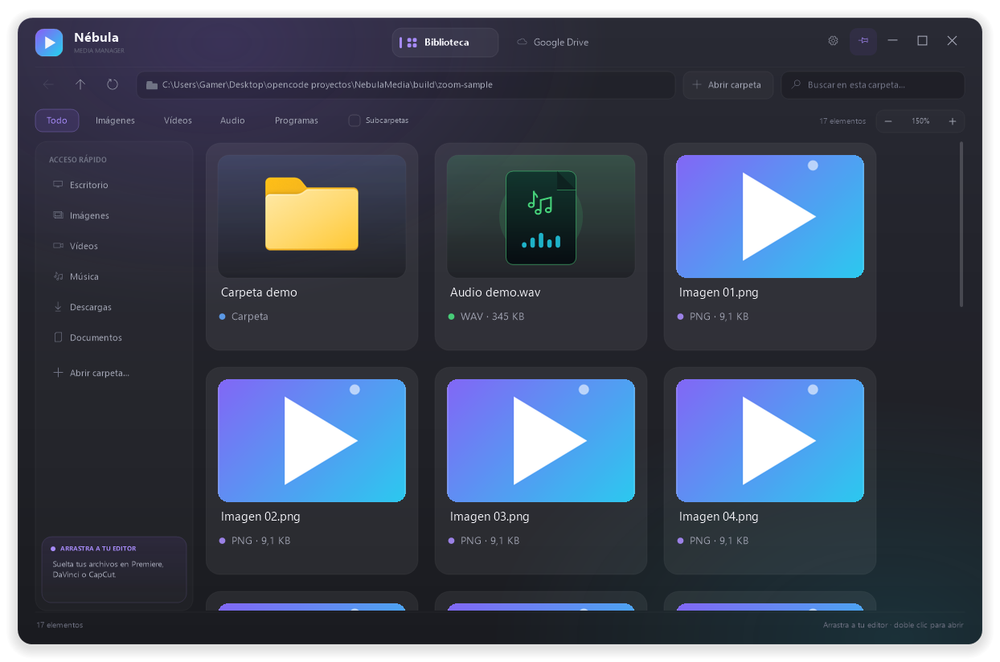
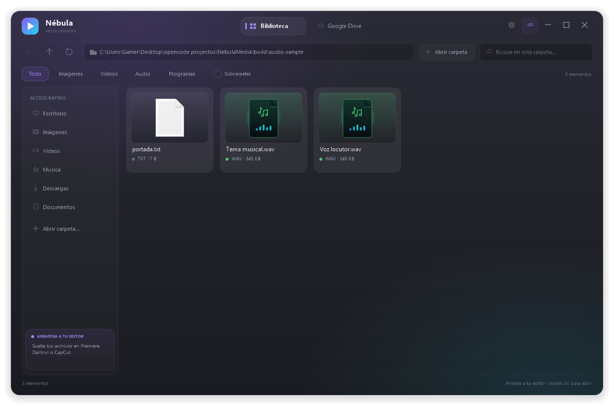
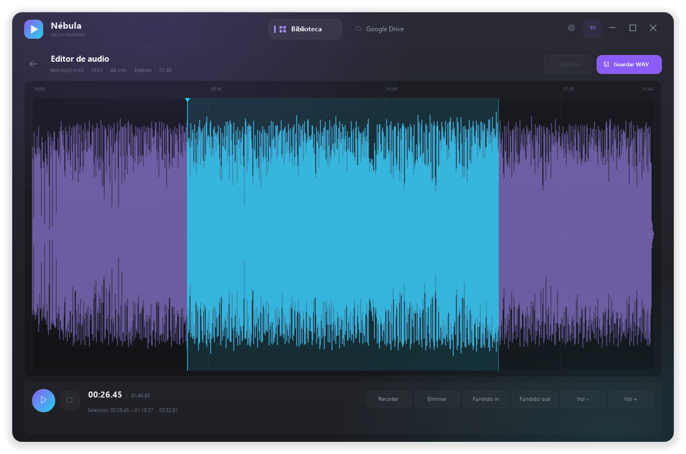

# Nébula Media

Gestor nativo de vídeos, imágenes y audio para Windows, con buscador, pestaña de Google Drive, arrastrar y soltar hacia otros programas, ventana siempre visible con fondo translúcido, actualizaciones automáticas y un editor de audio básico.

Repositorio: <https://github.com/joseestebanmarinrincones-dot/nebula-media>









> **Nota sobre "nivel kernel":** la interfaz, el drag & drop OLE y el editor de audio viven en modo usuario por diseño. Un driver kernel no puede crear ventanas ni usar OLE, y un fallo en él provocaría un BSOD. La app está escrita en C++ nativo Win32/COM (sin Electron, sin runtime externo) y usa directamente OLE, Shell, GDI+ y Media Foundation, que es la capa más baja segura para este tipo de programa.

## Características

- Biblioteca con miniaturas reales (Shell thumbnail provider) para imágenes, vídeos, audio y carpetas.
- Solo se detectan extensiones de audio, imagen y vídeo. Ejecutables, juegos, documentos y archivos desconocidos se ignoran.
- Filtros Todo / Imágenes / Vídeos / Audio.
- Zoom de tarjetas configurable (80–160%) con controles en la barra de filtros, Ctrl+rueda y Ctrl +/−/0. Se guarda en la configuración.
- Búsqueda instantánea en la carpeta actual y búsqueda recursiva ("Subcarpetas") con límites de seguridad.
- Drag out real con `CF_HDROP`: arrastra una o varias selecciones a Premiere, DaVinci Resolve, CapCut, After Effects, Explorer, etc. Durante el arrastre la ventana se aparta, se vuelve translúcida y deja pasar el puntero para poder soltar sobre un editor que estaba debajo.
- Pestaña Google Drive:
  - Detecta la unidad local de Google Drive para escritorio (`Mi unidad`).
  - Permite elegir cualquier carpeta sincronizada (por ejemplo, un mount de rclone).
  - Arrastra una carpeta de Drive a la ventana para usarla como raíz.
  - Marca archivos que solo están en la nube; se hidratan al abrirlos o arrastrarlos.
  - Copia archivos de la biblioteca a Drive sin pedir credenciales (usa la carpeta local).
- Editor de audio: onda con selección, reproducción con pausa, recortar, eliminar, fundidos, volumen, deshacer y exportación WAV.
- Miniaturas de audio propias (archivo musical con nota y forma de onda) en lugar del icono genérico de Windows.
- Ventana frameless con transparencia per-pixel, esquinas redondeadas, sombra y opacidad ajustable.
- Botón pin / opción "Mantener siempre arriba" (`WS_EX_TOPMOST`).
- **Actualizaciones automáticas** desde GitHub Releases: la app comprueba al abrir, descarga y verifica la nueva versión por SHA-256, y muestra un botón **Actualizar** para que el usuario decida cuándo instalarla.
- Instalador por usuario (sin UAC) generado con NSIS.

## Requisitos

- Windows 10/11 x64.
- Google Drive para escritorio para la integración de Drive (opcional).
- Códecs de Media Foundation para decodificar audio en el editor (MP3, WAV, M4A, etc.).
- Compilador LLVM-MinGW / MinGW-w64 con `g++`, `windres`; PowerShell 5+.
- NSIS 3.11 para generar el instalador (el script lo descarga si falta).

## Compilar

```powershell
cd NebulaMedia
powershell -ExecutionPolicy Bypass -File build.ps1
```

Salida: `dist\NebulaMedia.exe`. La versión se lee de `VERSION` y se puede
forzar con `build.ps1 -Version 1.2.3`.

## Generar el instalador

```powershell
powershell -ExecutionPolicy Bypass -File tools\make_installer.ps1
```

Salida: `dist\NebulaMedia-Setup-<version>.exe` y un ZIP portable.

El instalador se instala en `%LOCALAPPDATA%\Programs\Nebula Media`, con accesos en Inicio y Escritorio, y no pide permisos de administrador.

## Actualizaciones automáticas y GitHub

El release incluye `latest.txt` con la versión, la URL del ejecutable y su
SHA-256. Al abrir la app, esta consulta
`https://github.com/<owner>/<repo>/releases/latest/download/latest.txt`.
Si hay una versión nueva, la descarga y verifica. Cuando está lista aparece un
botón **Actualizar** en la cabecera; el usuario decide cuándo. Al pulsarlo, la
app se cierra, un script de PowerShell sustituye el `.exe` y la vuelve a abrir
ya actualizada. Si no lo pulsa, no se instala nada. Los amigos no tienen que
recibir archivos.

No hay firma Authenticode: la verificación es HTTPS + SHA-256 contra el mismo
release de GitHub. Si se mueve el repositorio, actualiza
`src/update_config.h`.

### Publicar una versión nueva

GitHub Actions está activo en `.github/workflows/release.yml`. Con los cambios
guardados, haz commit y push a `main`:

```powershell
git add -A
git commit -m "Mis cambios"
git push
```

El workflow incrementa el patch de `VERSION`, compila, genera el instalador y
el portable, publica el release y guarda `VERSION` con `[skip ci]`. Los amigos
con una versión anterior verán el botón **Actualizar** en su próxima apertura.

`publish.ps1` queda como respaldo manual: si GitHub Actions falla, se puede
usar `publish.ps1 -Force`. No mezcles ambos métodos para el mismo cambio.

## Estructura

```
src/
  common.h       Modelos, helpers y declaración de App
  app.cpp        Ventana, layout, navegación, Drive, editor y mensajes
  paint.cpp      Render GDI+ (UI, tarjetas, ondas, ajustes)
  util.cpp       Sistema de archivos, diálogos, registro, DRIVE
  thumbs.cpp     Miniaturas asíncronas con Shell
  dnd.cpp        IDataObject/IDropSource para arrastrar archivos
  audio.cpp      Media Foundation, WAV, reproducción waveOut
  update.cpp     Comprobación/descarga de GitHub, SHA-256 y auto-reemplazo
  update_config.h Repositorio de GitHub usado por el updater
  main.cpp       Arranque (DPI, OLE, GDI+)
res/             Icono, manifiesto y versión
tools/           Generador de recursos, build/test auxiliares
installer/       Script NSIS
publish.ps1      Compila, versiona, sube a GitHub y crea el release
docs/            Capturas y plantilla opcional del workflow de GitHub
```

## Configuración

Se guarda en `HKCU\Software\NebulaMedia`:

- `Library`: última carpeta de la biblioteca.
- `DriveRoot`: raíz de Drive elegida.
- `Opacity`: 100-255 (fondo).
- `Pin`: 0/1 (siempre visible).
- `Zoom`: 80-160 (tamaño de las tarjetas).
- `WinX`, `WinY`, `WinW`, `WinH`, `Maximized`: colocación.
- `InstallDir`: la escribe el instalador.

## Limitaciones conocidas

- El editor carga como máximo 10 minutos de audio para mantener el uso de memoria razonable.
- La exportación es WAV PCM 16 bits; no hay MP3 encoder.
- La integración de Drive no usa la API de Google ni guarda tokens: trabaja sobre la carpeta local de Drive para escritorio. Los archivos solo en la nube aparecen con un icono de nube y se descargan al usarlos.
- El arrastre hacia otros programas depende de que el destino acepte `CF_HDROP` (lo normal en editores de vídeo y Explorer).
- Windows (UIPI) bloquea arrastrar entre procesos con distinto nivel de integridad. Si el editor corre como administrador, hay que abrir Nébula Media con el mismo nivel.
- El instalador y las actualizaciones no están firmados; SmartScreen puede avisar.
- La app es x64.
- El auto-reemplazo usa Windows PowerShell y requiere que el ejecutable esté en una carpeta escribible (la instalación por usuario lo está).
- La actualización solo se aplica al pulsar el botón Actualizar; si se cierra sin pulsarlo, no se instala y se vuelve a ofrecer en el siguiente arranque.

## Licencia

MIT. Ver `LICENSE.txt`.
